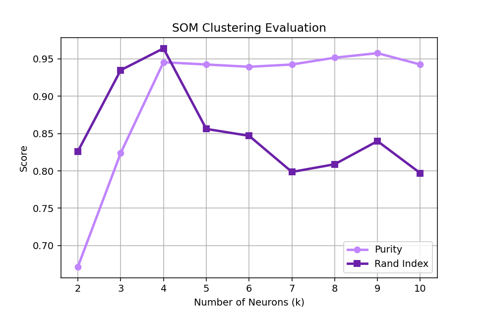
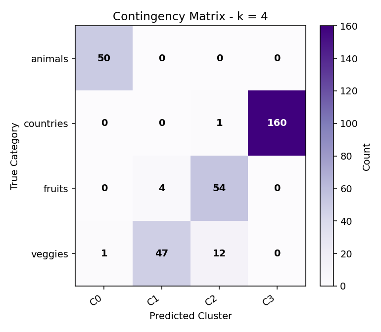
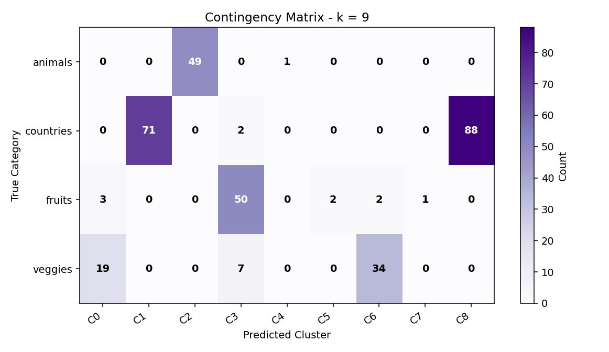
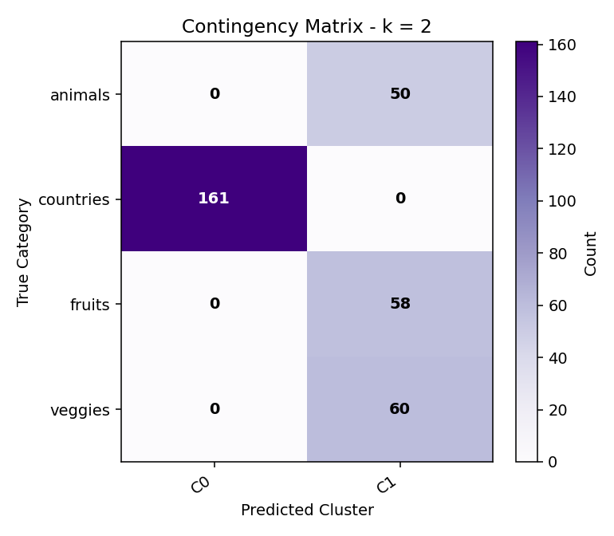
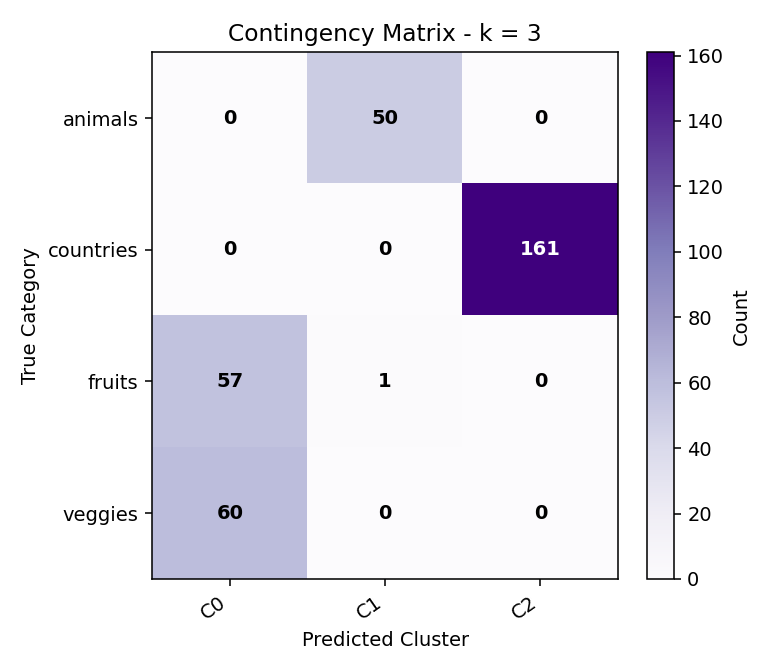
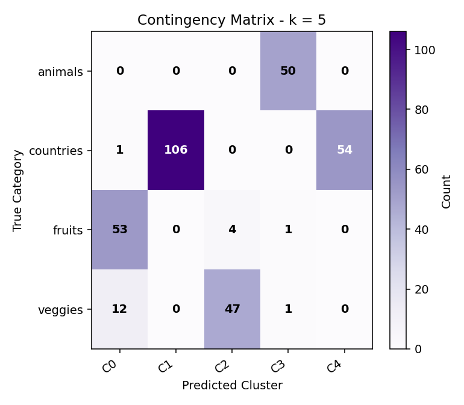
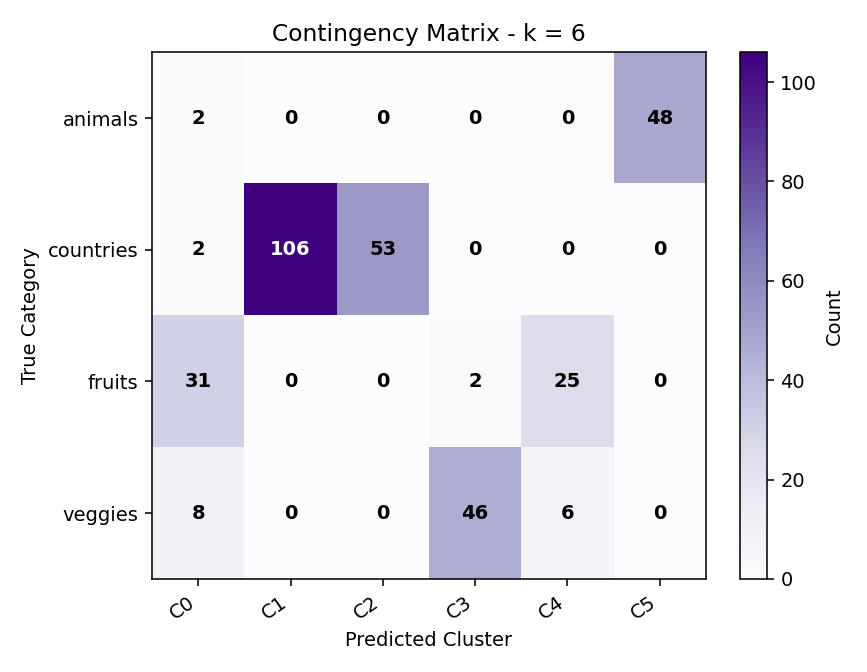
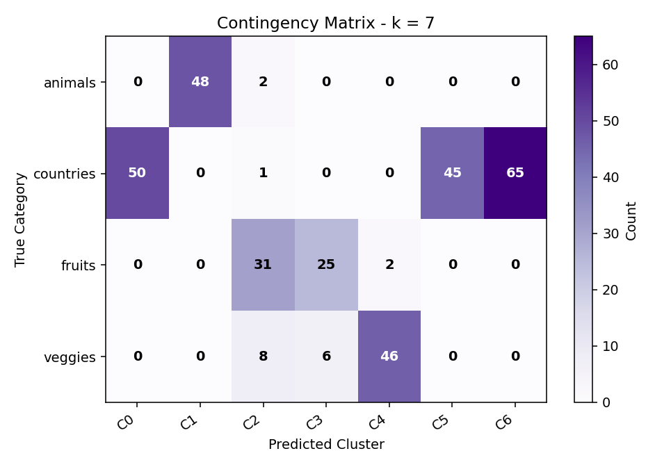
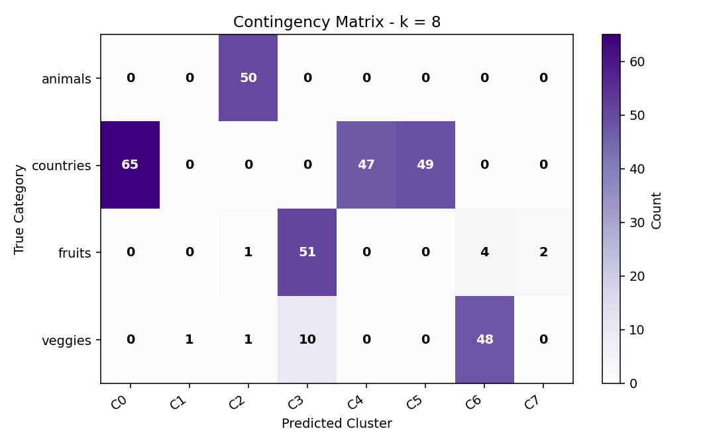
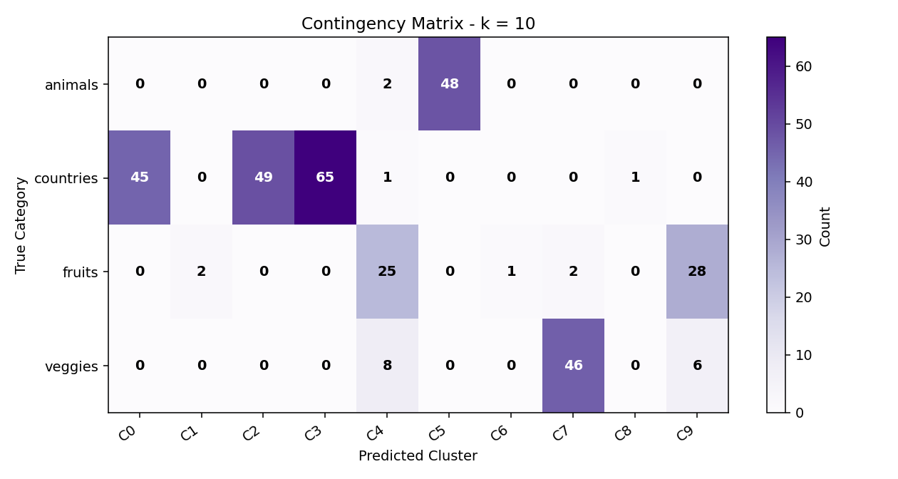

# SOM-Based Word Clustering

## Overview

This project explores unsupervised word clustering using a Self-Organizing Map (SOM) implemented **from scratch** with Python and NumPy, without any SOM library. It uses pre-trained GloVe word embeddings to represent words as numerical vectors and groups them based on Euclidean distance.

The project evaluates clustering performance across different numbers of neurons and compares the resulting clusters with the words' original categories.

## Dataset

The dataset contains 329 words across four categories:

- Animals (50 words)
- Countries (161 words)
- Fruits (58 words)
- Vegetables (60 words)

Each word is represented by a 300-dimensional GloVe embedding.

## Methodology

The project was implemented in Python using NumPy and follows these main steps:

1. Load the word embeddings and their category labels.
2. Initialize neuron weights using randomly selected data vectors with small random perturbations.
3. Calculate Euclidean distances to identify the Best Matching Unit (BMU) for each input vector.
4. Update only the winning neuron's (BMU) weights using a decreasing learning rate. Neighboring neurons are not updated.
5. Assign each word to its nearest neuron.
6. Evaluate clustering performance for neuron counts from k = 2 to k = 10.

Training settings: 70 epochs and an initial learning rate of 0.8 that decreases linearly. The global random seed is 50, and the seed is reset to the value of k before each training run to support reproducibility.

## Evaluation Metrics

- **Purity:** Measures how well the resulting clusters correspond to the dominant original category within each cluster.
- **Rand Index:** Measures agreement between the clustering assignments and the original category labels.

Contingency matrices and a combined metrics plot are generated to help inspect and compare the results.

## Results

| k | Purity | Rand Index |
|--:|-------:|-----------:|
| 2 | 0.6717 | 0.8262 |
| 3 | 0.8237 | 0.9346 |
| 4 | 0.9453 | 0.9638 |
| 5 | 0.9422 | 0.8561 |
| 6 | 0.9392 | 0.8469 |
| 7 | 0.9422 | 0.7986 |
| 8 | 0.9514 | 0.8088 |
| 9 | 0.9574 | 0.8398 |
| 10 | 0.9422 | 0.7969 |

The experiments produced the following best scores:

| Metric | Best Score | Number of Neurons |
|---|---:|---:|
| Purity | 95.74% | 9 |
| Rand Index | 96.38% | 4 |

The best score differs by metric, illustrating that clustering performance can be assessed from multiple perspectives. The best Rand Index appears at k = 4, which matches the true number of categories, while larger k values split categories into smaller clusters and raise Purity at the cost of Rand Index.

### Evaluation Plot



### Contingency Matrices

**k = 4** (best Rand Index)



**k = 9** (best Purity)



<details>
<summary>All contingency matrices (k = 2 to 10)</summary>









</details>


## Technologies

- Python
- NumPy
- Matplotlib
- scikit-learn (imported for optional validation; Purity and Rand Index are computed manually)

## Project Structure

```text
som-word-clustering/
├── som.py
├── DATA/
│   ├── animals.txt
│   ├── countries.txt
│   ├── fruits.txt
│   └── veggies.txt
├── RESULT/
│   ├── CM/
│   ├── metrics_plot.png
│   ├── results.csv
│   └── summary_results.txt
├── requirements.txt
└── README.md
```

## How to Run

1. Install Python.
2. Install the required libraries:

   ```bash
   pip install -r requirements.txt
   ```

3. Ensure the four dataset files are placed in the `DATA/` directory.
4. Run the main script from the project directory:

   ```bash
   python som.py
   ```

The script generates evaluation summaries and plots in the `RESULT/` directory.

##  Author

**Rawan Alotaibi**  
*Computer Science | Focused on Cybersecurity & SOC Operations*  
 [LinkedIn Profile][[(https://www.linkedin.com/in/rawan-alotaibi)](https://www.linkedin.com/in/rawan-alotaibi-](https://www.linkedin.com/in/rawan-alotaibi-077318431/)077318431/)
 

It was prepared and written in collaboration with my teammates on the project
